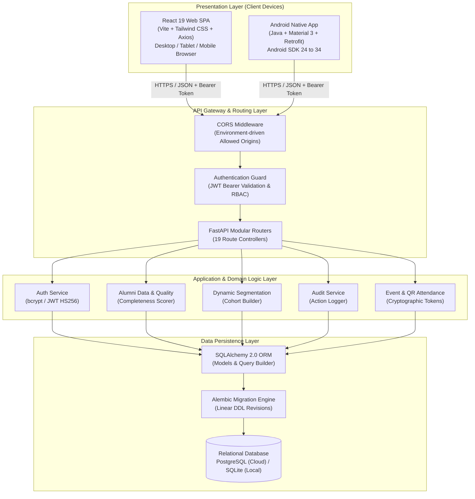
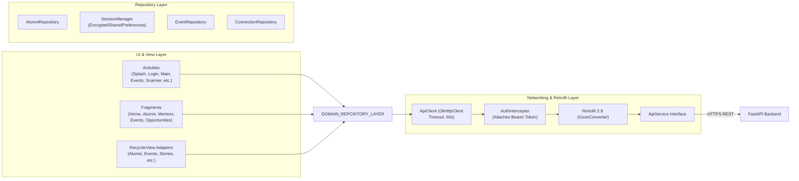

# AlumniConnect — System Architecture Specification

**Project Title:** AlumniConnect – Digital Platform for Centralized Alumni Data Management and Engagement  
**Document ID:** `FINAL_SUBMISSION/03_System_Architecture.md`  
**Target Audience:** Academic Examiners, System Architects, Technical Evaluators  

---

## 1. High-Level Architecture Overview

AlumniConnect utilizes a decoupled, modern three-tier client-server architecture. All client applications—whether running in a desktop browser or on a native Android mobile device—interact exclusively through a single authoritative REST API powered by FastAPI.



---

## 2. Client-Server Communication Protocol

### 2.1 Communication Contract
- **Protocol:** HTTPS (TLS 1.3 in production) / HTTP/1.1 (Local development).
- **Serialization Format:** JSON (`application/json`) across all requests and responses (except CSV multipart uploads).
- **Authentication Scheme:** `Authorization: Bearer <JWT_ACCESS_TOKEN>`.
- **Status Codes:** Standard HTTP semantics:
  - `200 OK`: Request succeeded with payload.
  - `201 Created`: Resource successfully created.
  - `400 Bad Request`: Input validation failed or business rule violation.
  - `401 Unauthorized`: Token missing, invalid, or expired.
  - `403 Forbidden`: Authenticated user lacks the required role.
  - `404 Not Found`: Target entity does not exist.

### 2.2 Vercel Reverse Proxy Architecture
To optimize latency and eliminate browser CORS preflight roundtrips on web deployments, `vercel.json` configures server-side reverse proxy rewrites:
```
Browser Request (/auth/login) ──> Vercel Edge Server ──(Internal Proxy)──> Render Backend (/auth/login)
```
If dynamic routing is needed, the frontend runtime dynamically evaluates `window.location.hostname` and falls back cleanly to the direct backend endpoint.

---

## 3. Android Mobile Architecture

The Android native application (`com.alumniconnect.app`) is designed using the **Model-Repository-View/Activity** architectural pattern for clean separation of concerns:



### Key Android Architectural Elements:
1. **Network Layer Isolation:** All API operations pass through `ApiClient` and `ApiService`. No UI component makes raw HTTP requests.
2. **Encrypted Session Management:** `SessionManager` utilizes `androidx.security.crypto.EncryptedSharedPreferences` backed by `MasterKey.KeyScheme.AES256_GCM`. The hardware KeyStore stores encryption keys.
3. **Resilient Network Config:** Timeouts are configured to 60 seconds across connect, read, and write operations to accommodate free-tier cloud instance cold starts without crashing.
4. **Hardware QR Scanner Integration:** `QRScannerActivity` leverages `com.journeyapps:zxing-android-embedded` to provide hardware-accelerated camera scanning with automatic flashlight controls and runtime permission management.

---

## 4. Cloud Deployment Architecture

The production cloud deployment leverages a zero-maintenance GitOps pipeline:

```mermaid
flowchart TD
    subgraph Source_Control ["GitHub Repository"]
        REPO["SujalTotala/AlumniConnect\n(master / main branches)"]
    end

    subgraph Vercel_Frontend ["Vercel Edge Cloud"]
        V_BUILD["Vercel Build\n(npm --prefix frontend install && run build)"]
        V_HOST["Vercel CDN Edge Network\n(alumni-connect-azure-mu.vercel.app)"]
        V_PROXY["Reverse Proxy Rewrites\n(/auth/*, /alumni/*, etc.)"]
    end

    subgraph Render_Backend ["Render Cloud Platform"]
        R_BUILD["Render Container Build\n(pip install -r requirements.txt\n&& alembic upgrade head)"]
        R_UVICORN["Uvicorn ASGI Process\n(app.main:app --port $PORT)"]
    end

    subgraph Cloud_Database ["Managed Cloud Storage"]
        PG[("Render Managed PostgreSQL\n(Version 16 - Multi-AZ SSD)")]
    end

    REPO -->|Git Webhook Push| V_BUILD
    REPO -->|Git Webhook Push| R_BUILD
    V_BUILD --> V_HOST
    V_HOST --> V_PROXY
    R_BUILD --> R_UVICORN
    V_PROXY -->|HTTPS API Requests| R_UVICORN
    R_UVICORN -->|Encrypted Pool (pg8000)| PG
```

### Deployment Configuration Highlights:
- **Zero Secrets in Repository:** All secrets (`SECRET_KEY`, `DATABASE_URL`) are injected strictly at runtime through cloud environment variable dashboards.
- **Automated Database Migration:** Render's build command executes `alembic upgrade head` before launching the Uvicorn worker, ensuring the relational schema is always up to date.
- **Cross-Origin Security:** CORS origins are restricted to verified client origins (`alumni-connect-azure-mu.vercel.app`, `localhost:5173`) with full preflight caching.

