# AlumniConnect — Database Design & Data Architecture

**Project Title:** AlumniConnect – Digital Platform for Centralized Alumni Data Management and Engagement  
**Document ID:** `FINAL_SUBMISSION/04_Database_Design.md`  
**Schema Version:** `d4e5f6a7b8c9` (Alembic Head)  
**Database Engines:** PostgreSQL 16 (Production) / SQLite 3 (Local Development)  

---

## 1. Entity-Relationship (ER) Diagram

```mermaid
erDiagram
    USERS ||--o| ALUMNI : "owns"
    USERS ||--o| STUDENT_PROFILES : "owns"
    USERS ||--o{ EVENT_REGISTRATIONS : "attends"
    USERS ||--o{ EVENT_ATTENDANCE : "checks-in"
    USERS ||--o{ MENTORSHIP_REQUESTS : "initiates/receives"
    USERS ||--o{ OPPORTUNITIES : "posts"
    USERS ||--o{ NOTIFICATIONS : "receives"
    USERS ||--o{ CONNECTIONS : "connects"
    USERS ||--o{ REFERRAL_REQUESTS : "seeks/refers"
    USERS ||--o{ COMMUNITY_MEMBERS : "joins"
    USERS ||--o{ COMMUNITY_POSTS : "publishes"
    USERS ||--o{ SUCCESS_STORIES : "shares"
    USERS ||--o{ ACHIEVEMENTS : "submits"
    USERS ||--o{ USER_BOOKMARKS : "saves"
    USERS ||--o| NOTIFICATION_PREFERENCES : "configures"
    USERS ||--o{ ADMIN_AUDIT_LOGS : "performs"

    EVENTS ||--o{ EVENT_REGISTRATIONS : "has"
    EVENTS ||--o{ EVENT_ATTENDANCE : "tracks"
    OPPORTUNITIES ||--o{ REFERRAL_REQUESTS : "receives"
    COMMUNITIES ||--o{ COMMUNITY_MEMBERS : "contains"
    COMMUNITIES ||--o{ COMMUNITY_POSTS : "hosts"
    ALUMNI_SEGMENTS ||--o{ ANNOUNCEMENTS : "targets"
    ALUMNI_IMPORT_JOBS ||--o{ ADMIN_AUDIT_LOGS : "records"

    USERS {
        int id PK
        string name
        string email UK
        string password
        string role
        boolean is_active
        datetime created_at
    }

    ALUMNI {
        int id PK
        int user_id FK
        string name
        string email UK
        string graduation_year
        string degree
        string department
        string company
        string job_role
        string location
        string linkedin_url
        boolean mentorship_available
        boolean is_verified
    }

    STUDENT_PROFILES {
        int id PK
        int user_id FK
        string department
        string current_year
        string skills
        string bio
        string github_url
        string linkedin_url
    }

    EVENTS {
        int id PK
        int organizer_id FK
        string title
        string description
        string date
        string location
        string event_type
        int capacity
        boolean is_published
    }

    EVENT_ATTENDANCE {
        int id PK
        int event_id FK
        int user_id FK
        datetime checked_in_at
        string check_in_method
        int verified_by_admin_id FK
    }

    CONNECTIONS {
        int id PK
        int requester_id FK
        int receiver_id FK
        string status
        datetime created_at
        datetime updated_at
    }

    REFERRAL_REQUESTS {
        int id PK
        int opportunity_id FK
        int student_id FK
        int alumni_id FK
        string resume_url
        string notes
        string status
        datetime created_at
    }

    ALUMNI_SEGMENTS {
        int id PK
        string name UK
        string description
        string filter_rules
        int created_by_admin_id FK
    }

    ALUMNI_IMPORT_JOBS {
        int id PK
        string filename
        int total_rows
        int successful_rows
        int failed_rows
        string status
        int admin_user_id FK
    }

    ADMIN_AUDIT_LOGS {
        int id PK
        int admin_user_id FK
        string action
        string target_type
        int target_id
        string details
        datetime created_at
    }
```

---

## 2. Relational Table Specifications

### 2.1 Core Identity & Profile Tables

#### `users`
Master user accounts across all platform roles.
- `id` (INTEGER, Primary Key, Auto-increment)
- `name` (VARCHAR(150), Not Null)
- `email` (VARCHAR(255), Unique, Indexed, Not Null) — Always stored in normalized lowercase.
- `password` (VARCHAR(255), Not Null) — Salted bcrypt hash string.
- `role` (VARCHAR(50), Not Null, Default: `'student'`) — Values: `'student'`, `'alumni'`, `'admin'`.
- `is_active` (BOOLEAN, Default: `True`) — Account status flag.
- `created_at` (DATETIME, Default: Current UTC timestamp).

#### `alumni`
Detailed professional directory records for graduates.
- `id` (INTEGER, Primary Key, Auto-increment)
- `user_id` (INTEGER, Foreign Key → `users.id`, Nullable, Indexed, `ON DELETE SET NULL`)
- `name` (VARCHAR(150), Not Null)
- `email` (VARCHAR(255), Unique, Indexed, Not Null)
- `graduation_year` (VARCHAR(20), Nullable, Indexed)
- `degree` (VARCHAR(100), Nullable)
- `department` (VARCHAR(100), Nullable, Indexed)
- `company` (VARCHAR(150), Nullable, Indexed)
- `job_role` (VARCHAR(150), Nullable)
- `location` (VARCHAR(150), Nullable)
- `linkedin_url` (VARCHAR(255), Nullable)
- `mentorship_available` (BOOLEAN, Default: `False`, Indexed)
- `is_verified` (BOOLEAN, Default: `False`, Indexed)
- `created_at`, `updated_at` (DATETIME)

#### `student_profiles`
Extended academic background and aspirational details for current students.
- `id` (INTEGER, Primary Key, Auto-increment)
- `user_id` (INTEGER, Foreign Key → `users.id`, Unique, Not Null, `ON DELETE CASCADE`)
- `department` (VARCHAR(100), Nullable)
- `current_year` (VARCHAR(20), Nullable)
- `skills` (TEXT, Nullable)
- `bio` (TEXT, Nullable)
- `github_url` (VARCHAR(255), Nullable)
- `linkedin_url` (VARCHAR(255), Nullable)

---

### 2.2 Engagement & Networking Tables

#### `connections`
Tracks professional network links between community members.
- `id` (INTEGER, Primary Key, Auto-increment)
- `requester_id` (INTEGER, Foreign Key → `users.id`, Not Null, `ON DELETE CASCADE`)
- `receiver_id` (INTEGER, Foreign Key → `users.id`, Not Null, `ON DELETE CASCADE`)
- `status` (VARCHAR(30), Default: `'PENDING'`) — Values: `'PENDING'`, `'ACCEPTED'`, `'REJECTED'`.
- `created_at`, `updated_at` (DATETIME)
- **Constraint:** Unique composite constraint on `(requester_id, receiver_id)` to prevent duplicate requests.

#### `referral_requests`
Formal student requests to alumni for internal employment referrals.
- `id` (INTEGER, Primary Key, Auto-increment)
- `opportunity_id` (INTEGER, Foreign Key → `opportunities.id`, Not Null, `ON DELETE CASCADE`)
- `student_id` (INTEGER, Foreign Key → `users.id`, Not Null, `ON DELETE CASCADE`)
- `alumni_id` (INTEGER, Foreign Key → `users.id`, Not Null, `ON DELETE CASCADE`)
- `resume_url` (VARCHAR(500), Nullable)
- `notes` (TEXT, Nullable)
- `status` (VARCHAR(30), Default: `'PENDING'`) — Values: `'PENDING'`, `'ACCEPTED'`, `'REJECTED'`, `'COMPLETED'`.
- `created_at`, `updated_at` (DATETIME)

#### `mentorship_requests`
Two-way structured mentorship engagement proposals.
- `id` (INTEGER, Primary Key, Auto-increment)
- `student_id` (INTEGER, Foreign Key → `users.id`, Not Null, `ON DELETE CASCADE`)
- `alumni_id` (INTEGER, Foreign Key → `users.id`, Not Null, `ON DELETE CASCADE`)
- `topic` (VARCHAR(200), Not Null)
- `message` (TEXT, Not Null)
- `status` (VARCHAR(30), Default: `'PENDING'`)
- `created_at`, `updated_at` (DATETIME)

---

### 2.3 Events, Attendance & Community Tables

#### `events` & `event_attendance`
Campus events and contactless attendance tracking.
- `events`: `id`, `title`, `description`, `date`, `location`, `organizer_id` (FK → `users.id`), `capacity`, `is_published`.
- `event_attendance`: `id`, `event_id` (FK → `events.id`, `ON DELETE CASCADE`), `user_id` (FK → `users.id`, `ON DELETE CASCADE`), `checked_in_at`, `check_in_method` (`'QR_SCAN'`, `'MANUAL'`), `verified_by_admin_id` (FK → `users.id`, Nullable).
- **Constraint:** Unique constraint on `(event_id, user_id)` guarantees one verified check-in per user per event.

#### `communities`, `community_members`, `community_posts`
Interest-driven discussion forums.
- `communities`: `id`, `name` (Unique), `description`, `category`, `created_by` (FK → `users.id`).
- `community_members`: `id`, `community_id` (FK), `user_id` (FK), `role` (`'member'`, `'moderator'`), `joined_at`.
- `community_posts`: `id`, `community_id` (FK), `author_id` (FK), `title`, `content`, `created_at`.

---

### 2.4 Governance, Data Quality & Audit Tables (Pass 3A)

#### `alumni_segments`
Saved dynamic query rules for institutional cohort communications.
- `id` (INTEGER, Primary Key, Auto-increment)
- `name` (VARCHAR(150), Unique, Not Null)
- `description` (TEXT, Nullable)
- `filter_rules` (JSON / TEXT, Not Null) — Stores JSON criteria (department, batch_min, batch_max, company, verified_only).
- `created_by_admin_id` (INTEGER, Foreign Key → `users.id`, Nullable)
- `created_at`, `updated_at` (DATETIME)

#### `alumni_import_jobs`
Metadata and reconciliation statistics for bulk CSV imports.
- `id` (INTEGER, Primary Key, Auto-increment)
- `filename` (VARCHAR(255), Not Null)
- `total_rows` (INTEGER, Default: 0)
- `successful_rows` (INTEGER, Default: 0)
- `failed_rows` (INTEGER, Default: 0)
- `mode` (VARCHAR(50), Default: `'update_existing'`)
- `status` (VARCHAR(50), Default: `'completed'`)
- `admin_user_id` (INTEGER, Foreign Key → `users.id`, Nullable)
- `created_at`, `completed_at` (DATETIME)

#### `admin_audit_logs`
Immutable administrative event log.
- `id` (INTEGER, Primary Key, Auto-increment)
- `admin_user_id` (INTEGER, Foreign Key → `users.id`, Nullable, Indexed, `ON DELETE SET NULL`)
- `action` (VARCHAR(100), Not Null, Indexed) — e.g., `'IMPORT_ALUMNI'`, `'APPROVE_STORY'`, `'CREATE_SEGMENT'`.
- `target_type` (VARCHAR(50), Not Null, Indexed) — e.g., `'alumni'`, `'story'`, `'segment'`.
- `target_id` (INTEGER, Nullable)
- `details` (TEXT, Nullable)
- `created_at` (DATETIME, Indexed, Default: Current UTC)

---

## 3. Relational Normalization Analysis

The database schema adheres strictly to **Third Normal Form (3NF)** principles:

1. **First Normal Form (1NF):**
   - Every column contains atomic values. Multi-valued attributes (such as event registrations, community members, or bookmarks) are segregated into dedicated association tables.
   - Primary keys uniquely identify each row across all 21 tables.
2. **Second Normal Form (2NF):**
   - All non-key attributes are fully functionally dependent on the entire primary key. In compound relationship tables (`connections`, `event_attendance`), foreign key pairs constitute natural composite keys, with surrogate autoincrement primary keys utilized for performance.
3. **Third Normal Form (3NF):**
   - Transitive dependencies are eliminated. For example, student-specific profile fields (github, year) reside in `student_profiles`, while alumni employment fields (company, mentorship) reside in `alumni`. Modifying an alumnus's employer does not alter user credentials or student records.

