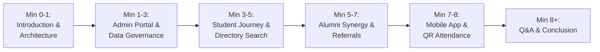

# AlumniConnect — Project Demonstration Guide

**Project Title:** AlumniConnect – Digital Platform for Centralized Alumni Data Management and Engagement  
**Document ID:** `FINAL_SUBMISSION/08_Project_Demo_Guide.md`  
**Estimated Demonstration Duration:** 8 to 10 Minutes  
**Target Audience:** Academic Project Evaluation Committee, External Examiners  

---

## 1. Pre-Demonstration Setup & Credentials

### 1.1 Target Environments
- **Primary Web Screen:** [https://alumni-connect-azure-mu.vercel.app/](https://alumni-connect-azure-mu.vercel.app/)
- **Mobile Device Screen:** Physical Android Phone or Emulator running `AlumniConnect-ProjectReview-v1.0.apk`.
- **Backend Warm-up:** If using the free-tier cloud backend, open `https://alumniconnect-bwoi.onrender.com/health` 2 minutes prior to ensure the instance is active.

### 1.2 Demonstration Accounts Matrix

| Role | Email Address | Password | Demonstration Focus |
| :--- | :--- | :--- | :--- |
| **System Admin** | `admin@alumni.edu` | `AdminPassword123!` | Ingestion, data quality score, dynamic segments, audit logs |
| **Verified Alumnus** | `alumni@alumni.edu` | `AlumniPassword123!` | Mentorship availability, posting jobs, accepting referrals |
| **Student** | `student@alumni.edu` | `StudentPassword123!` | Search, mentorship request, job referral, QR attendance |

---

## 2. Timed 8-Minute Demonstration Flow

---

### Step 1: Introduction & Architecture Overview (0:00 – 1:00)
- **Action:** Open the home page [https://alumni-connect-azure-mu.vercel.app/](https://alumni-connect-azure-mu.vercel.app/).
- **Spoken Points:**
  - "AlumniConnect is a unified digital platform bridging colleges, students, and graduates."
  - "The architecture features a single authoritative FastAPI REST API serving both a React 19 web application and native Android mobile app from a shared relational database."
- **Expected Visual:** Clean, modern login interface with institutional branding.

---

### Step 2: Administrator Data Governance & CSV Pipeline (1:00 – 3:00)
- **Action:** Log in as Administrator (`admin@alumni.edu`).
- **Demonstrate:**
  1. **Analytics Dashboard:** Show real-time KPI cards (Total Users, Registered Alumni, Active Mentorships).
  2. **Data Quality Dashboard:** Open `/admin/alumni-data`. Point out the automated completeness health score across emails, phone numbers, and LinkedIn links.
  3. **Bulk CSV Ingestion:** Open the CSV Import tab. Upload a sample batch CSV. Show the **instant preview** catching invalid email rows and reporting valid entries before committing.
  4. **Dynamic Cohort Segments:** Show how administrators can define segments (e.g., "CSE Alumni in Software Roles") and dispatch targeted announcements.
  5. **Audit Logs:** Show that administrative actions are permanently logged with timestamps and admin IDs.
- **Expected Result:** High-speed administrative workflows demonstrate institutional data control.

---

### Step 3: Student Discovery & Mentorship Proposal (3:00 – 5:00)
- **Action:** Log out of Admin, log in as Student (`student@alumni.edu`).
- **Demonstrate:**
  1. **Alumni Directory:** Navigate to `/alumni`. Type `"Google"` or `"Software"` in the search filter.
  2. **Filter Open Mentors:** Check the "Available for Mentorship" toggle to isolate senior graduates open to helping.
  3. **View Alumnus Profile:** Open Demo Alumni's profile card, showing their degree batch, skills, and current employer.
  4. **Dispatch Mentorship Request:** Click **"Request Mentorship"**, select topic `"Career Guidance & Mock Interview"`, submit proposal. Show that the proposal is logged in **Sent Requests** as `PENDING`.
- **Expected Result:** Instant real-time UI feedback confirms submission.

---

### Step 4: Alumni Synergy, Job Opportunities & Referrals (5:00 – 7:00)
- **Action:** Switch browser window or incognito session; log in as Alumnus (`alumni@alumni.edu`).
- **Demonstrate:**
  1. **Mentorship Inbox:** Open `/mentorship`. Show the incoming proposal from the student. Click **Accept**.
  2. **Post Career Opportunity:** Navigate to `/opportunities`. Click **"Post Opportunity"**, fill in `"Software Engineer Intern - Google Cloud"`, and publish.
  3. **Review Referrals:** Show how students can submit referral requests attached to their resumes, and alumni can mark them as `ACCEPTED`.
  4. **Community Discussion:** Open `/communities`. Show the departmental hub and post a quick discussion item.
- **Expected Result:** Complete two-way loop between student seeker and graduate mentor.

---

### Step 5: Android Mobile Parity & QR Event Check-In (7:00 – 8:30)
- **Action:** Display Android Mobile device / screen mirror running `AlumniConnect-ProjectReview-v1.0.apk`.
- **Demonstrate:**
  1. **Mobile Login:** Log in as student using the native Material 3 interface.
  2. **Session Persistence:** Close the app completely and reopen; show that `EncryptedSharedPreferences` restores the session instantly without login prompt.
  3. **Native Event Attendance:**
     - On the Web screen (as Admin or Event Organizer), open the event details to display the dynamic event QR code.
     - On the Android phone, tap **Events** → Select Event → Tap **Scan QR Code**.
     - Point camera at the screen QR code.
     - Show the instant confirmation banner on mobile: `"Checked in successfully via QR"`.
     - Refresh the Web event roster to show the student's attendance marked in real-time.
- **Expected Result:** Cross-platform data synchronization verified live.

---

### Step 6: Conclusion & Committee Q&A (8:30 – 10:00)
- **Key Summary Points:**
  - "AlumniConnect unifies 3 distinct user groups through 21 normalized database tables."
  - "Security is strictly enforced through bcrypt salted hashes, stateless JWT bearer tokens, and hardware-backed mobile KeyStore encryption."
  - "100% automated test pass rate across 51 comprehensive regression tests."

